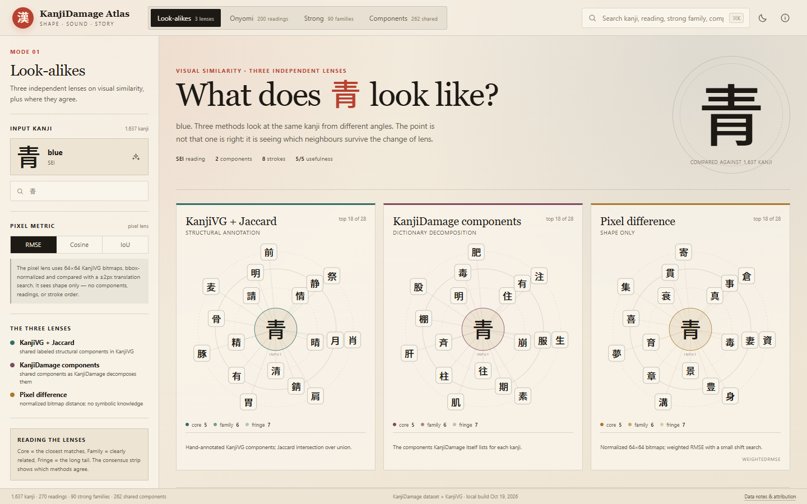
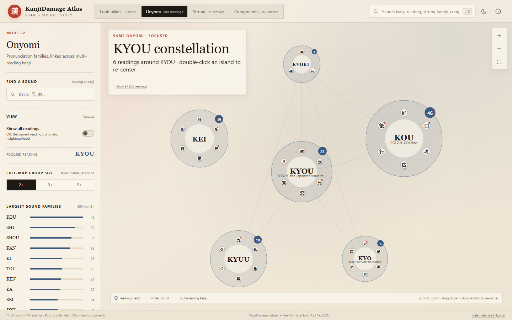
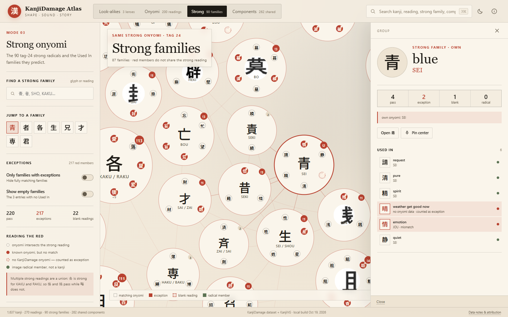
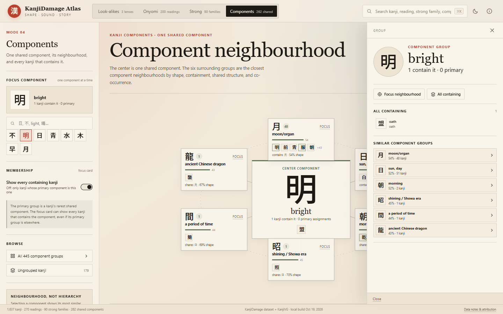
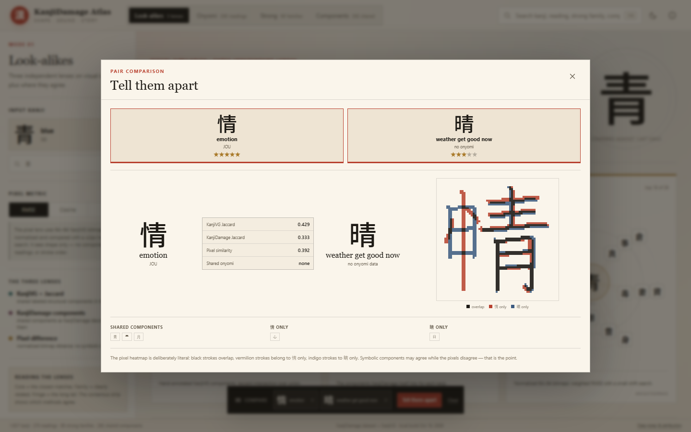
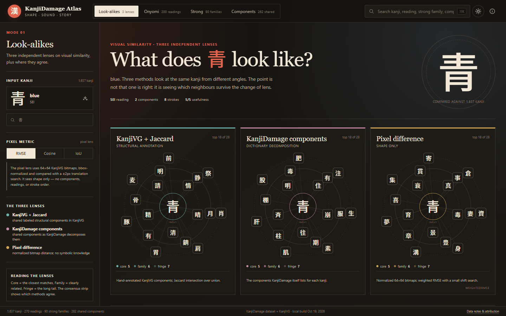

# KanjiDamage Atlas

An interactive field guide to confusable kanji: group the KanjiDamage set by shape, component, and
pronunciation, then compare any two to see exactly where the resemblance ends.

> **Status:** implemented as a local web app. Data is generated from the public sources; no runtime
> scraping and no external services.

## What it does

| Mode | What it shows |
|---|---|
| **Look-alikes** | Three independent visual-similarity lenses (KanjiVG Jaccard, KanjiDamage components, normalized pixel difference) plus a consensus strip showing where they agree and disagree. |
| **Onyomi** | A focused sound constellation (default KYOU) with phonetic neighbours and multi-reading threads. “Show all readings” opens the full 200-island map. |
| **Strong onyomi** | All 90 tag-24 strong families. Members whose onyomi does not match the strong reading are red; blank readings count as exceptions. Click a family to zoom in and see its Used In list and provenance. |
| **Components** | A focused component neighbourhood: one shared component, its six closest component groups, and every containing kanji. Browse all 445 components. |
| **Compare** | Pin up to three kanji, then open “Tell them apart” for shared/unique components, onyomi overlap, and a pixel-difference heatmap. |

Search works across kanji, meanings, readings, strong families, and components. Views are URL-encoded;
light and dark “sumi atlas” themes are included.

## Quick start

Requires Node **20.19+** or **22.12+**.

~~~bash
npm install
npm run data:all   # fetch sources, build the atlas data, validate it
npm run dev
~~~

Then open the printed URL (default http://127.0.0.1:5173).

The data step is one-time. It downloads the KanjiDamage dataset JSON, KanjiVG SVGs, the repository
font and radical images, and three cached KanjiDamage site snapshots. It then renders 1,641 normalized
glyphs and derives all groups. Later runs reuse `data/raw` and `public/data`.

> In the sandboxed DSH environment, npm lifecycle scripts can hit `EPERM`. If plain `npm install`
> fails, run `npm install --ignore-scripts`; the Vite/Rolldown and sharp binaries are prebuilt and do
> not need lifecycle scripts.

~~~bash
npm run build      # typecheck + production bundle
npm run serve      # serve dist/ at http://127.0.0.1:4173
npm run test       # unit tests
npm run data:validate
~~~

### npm cache note

`.npmrc` keeps npm’s cache inside the project (`.npm-cache/`, gitignored) because the default cache is
outside the writable workspace in this environment. On another machine, npm will simply create its
cache in the project.

## Data at a glance

| Fact | Value |
|---|---|
| KanjiDamage entries | **1,758** = 1,637 kanji + 121 image radicals |
| Site-only entries | 10: 閥 merged as a first-class entry; 9 katakana radicals catalogued but not mixed into groups |
| Strong families (tag 24) | **90**; 441 Used In references = 437 kanji members + 4 image-radical members; 3 empty families (定, 倍, 傷) |
| Onyomi | **270** groups; **200** with at least two kanji; **47** multi-reading kanji |
| Kanji with no onyomi | **139** — left blank, never guessed |
| Components | **445** character-component groups; **262** shared by at least two kanji; **179** ungrouped kanji |
| Pixel embeddings | **1,641** normalized 64×64 glyphs; **1,635** entries have a KanjiVG file (￥ and < do not) |
| Strong exceptions | 217 red members, including 22 blank-reading exceptions |

## Screenshots

### A focused sound constellation

The default KYOU focus keeps the map readable: phonetic neighbours and the other readings of its
multi-reading kanji (兄 links KYOU to KEI) are arranged around the centre. The full map is one click
away and remains available for overview.

### The strong 青 family

青 is strong for SEI. 請/清/精/静 pass; 晴 has no KanjiDamage onyomi and 情 is JOU, so both are red.
Every family has a provenance line, counts, and the complete Used In list.

### Component neighbourhood

The component focus makes the 明 ↔ 日/月/朝 relationship visible. Every card shows its members, the
shape/containment/shared-structure reason for the edge, and a primary-component marker.

### Compare

Black strokes overlap; vermilion belongs to the first kanji; indigo to the second. Symbolic components
may agree while pixels disagree — that is the point.

### Dark mode

## How the modes work

- **KanjiVG + Jaccard:** labeled `kvg:element` sets from the KanjiVG SVGs; intersection over union.
- **KanjiDamage components:** the dataset’s `components[]`; intersection over union.
- **Pixel difference:** KanjiVG glyphs rendered to a bbox-normalized 64×64 grayscale bitmap; weighted
  RMSE with a ±2px translation search. Cosine and ink-IoU are selectable.
- **Onyomi:** 270 reading groups. Similar readings form a sparse phonetic graph (romaji edit distance,
  initial consonant, vowel sequence, consonant skeleton). The full map uses the global layout; the
  focus view uses a compact radial neighbourhood.
- **Strong onyomi:** a curated 90-entry reading table built from each entry’s description note where
  present, otherwise its own onyomi. Multiple strong readings are a union. A member with no onyomi is a
  no-reading exception (晴), not a guessed match.
- **Components:** each kanji’s primary group is its rarest shared character component. The focus
  neighbourhood is ranked by shape overlap (dilated IoU), containment, shared structural labels, and
  co-occurrence. Every containing kanji can be shown, even if its primary group is elsewhere.

## What the atlas deliberately does not do

- It does **not** invent readings. If KanjiDamage leaves an onyomi blank, the atlas leaves it blank.
- It does **not** scrape the site at runtime. The tag-24 page, the /kanji index, and 閥 are fetched once
  and cached under `data/raw/site/`.
- It does **not** use an external dictionary to fill strong-reading gaps. The reviewed overrides live in
  `data/curated/strong-readings.json`.
- It does **not** hide data gaps: the Info dialog and the data-quality notes list the empty families,
  blank readings, ungrouped kanji, site-only radicals, and missing KanjiVG glyphs.

## Repository layout

~~~text
docs/ARCHITECTURE.md      approved design + implementation notes
docs/screenshots/          visual QA captures
data/raw/                  cached downloads (gitignored)
data/curated/              reviewed strong readings, supplements, overrides
public/data/               generated app data (gitignored)
public/fonts/              Noto Sans JP (generated from the dataset media)
public/media/strong/       strong-radical images (generated)
scripts/                   fetch, build, validate, serve
src/                       React app
tests/                     Vitest unit tests
~~~

Generated assets are not committed. Run `npm run data:all` after cloning.

## Sources and attribution

- **KanjiDamage** dataset: https://github.com/benchi2202/Kanjidamage-dataset (canonical). KanjiDamage
  content and media belong to their author(s); this is an unofficial study tool.
- **KanjiVG**: https://kanjivg.tagaini.net/ — CC BY-SA 3.0; used for labeled components and normalized
  bitmaps. Attribution and share-alike terms apply to derived KanjiVG data.
- **Noto Sans JP**: SIL Open Font License 1.1; bundled from the dataset media.

See [ATTRIBUTION.md](ATTRIBUTION.md) for full notes.

## Architecture

The approved design, data audit, algorithms, and acceptance tests are in
[docs/ARCHITECTURE.md](docs/ARCHITECTURE.md). Implementation notes record the small changes made after
visual testing: focused onyomi and component layouts, and full-map toggles.

## Tests

~~~bash
npm run test
npm run data:validate
npm run typecheck
~~~

The validator checks counts, the 青/者/各 exemplars, 兄 across KYOU/KEI, the 不 component group, the
明 neighbourhood, the 閥 supplement, and the pixel binary.